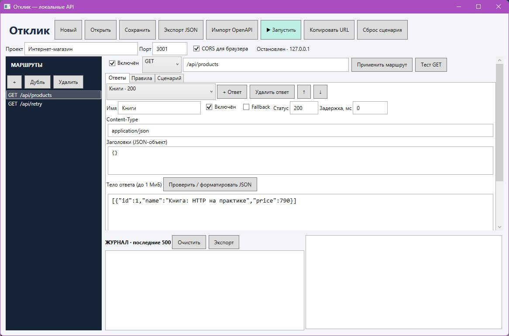
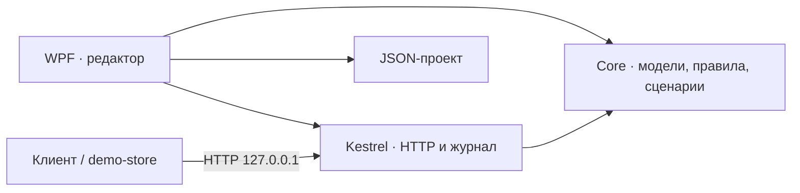

# Отклик · детерминированная эмуляция API

[](https://github.com/I-F-E-N-I-X-I/otklik/actions/workflows/ci.yml)


**Настольное приложение, которое возвращает нужный HTTP-ответ в нужный момент теста.**

Если backend ещё не готов или сложно воспроизвести ошибку сервера, Отклик позволяет задать ответы, условия, задержки и последовательности. Клиент обращается к настоящему локальному HTTP-серверу; в журнале видно, почему выбран именно этот ответ.

[Скачать для Windows](https://github.com/I-F-E-N-I-X-I/otklik/releases/latest) · [Руководство](docs/USER_GUIDE.md) · [Архитектура](docs/ARCHITECTURE.md) · [Результаты проверок](docs/VERIFICATION.md)



## Показательный сценарий

Один и тот же запрос `GET /api/retry` последовательно возвращает:

| Запрос | Ответ | Что проверяет клиент |
|---|---|---|
| Первый | `500` | Обработку ошибки |
| Второй | `503` через 1 секунду | Индикатор загрузки и повтор запроса |
| Третий | `200` с телом `[]` | Пустое состояние интерфейса |
| Следующие | `200` | Поведение `holdLast` |

Кнопка **«Сброс сценария»** возвращает последовательность к первому шагу. В режиме `loop` последовательность повторяется.

Детерминированность относится к выбору ответа при одинаковой конфигурации, состоянии и порядке обработки запросов. Время доставки и порядок прихода параллельных запросов зависят от среды.

## Возможности

- Редактор маршрутов `GET`, `POST`, `PUT`, `PATCH`, `DELETE`, параметров пути и нескольких ответов.
- Выбор ответа по query-параметрам, заголовкам, пути и полям JSON: `equals`, `contains`, `exists`.
- Последовательности ответов, циклы, ручной сброс и задержки до 60 секунд.
- Журнал с кодом ответа, длительностью, причиной выбора правила и экспортом в JSON.
- Сохранение проектов в JSON и ограниченный импорт OpenAPI 3.0 JSON.
- Демонстрационный магазин на HTML/JavaScript с реальными `fetch`-запросами.

## Запуск за две минуты

1. Скачайте `otklik-windows-x64.zip` из [Releases](https://github.com/I-F-E-N-I-X-I/otklik/releases/latest).
2. Распакуйте **весь архив** и запустите `Отклик.exe`. Автономный пакет уже включает среду .NET.
3. Оставьте демонстрационный проект «Интернет-магазин» и нажмите **«Запустить»**.
4. Откройте `http://127.0.0.1:3001/api/products` или выполните:

```powershell
curl.exe -i "http://127.0.0.1:3001/api/products"
curl.exe -i "http://127.0.0.1:3001/api/products?category=books"
curl.exe -i "http://127.0.0.1:3001/api/retry"
```

Первый адрес возвращает два товара, второй — одну книгу. Для проверки последовательности вызовите третий адрес несколько раз и посмотрите журнал.

Для демонстрации состояний интерфейса запустите из папки приложения:

```powershell
python -m http.server 8080 --bind 127.0.0.1 --directory samples/demo-store
```

Нужен Python 3. Откройте `http://127.0.0.1:8080` при работающем Отклик с включённым CORS.

## Как устроено



| Компонент | Ответственность |
|---|---|
| [MockLab.Core](src/MockLab.Core) | Валидация, маршрутизация, правила, счётчики сценариев, формат проекта, импорт |
| [MockLab.Server](src/MockLab.Server) | Жизненный цикл Kestrel, HTTP, отмена запросов, ограничения и журнал |
| [MockLab.Desktop](src/MockLab.Desktop) | WPF-интерфейс, редактор и файловые диалоги |
| [MockLab.Tests](tests/MockLab.Tests) | 49 автоматических проверок, включая реальные HTTP-запросы |

Внутренние имена `MockLab.*` сохранены от рабочего названия проекта.

### Решения, которые можно посмотреть в коде

- **Снимок конфигурации при запуске:** редактирование проекта не меняет уже работающий сервер. Для применения нужен перезапуск.
- **Согласованный выбор шага:** счётчик защищён `lock`; искусственная задержка выполняется за его пределами и не блокирует остальные запросы.
- **Отмена при остановке:** сервер связывает отмену клиента и собственный сигнал завершения.
- **Сохранение через временный файл:** проверенная конфигурация записывается рядом с целевым файлом, затем заменяет его.
- **Ограничение ресурсов:** тело запроса до 1 МиБ, ограниченный журнал и усечение длинного текста. Известные чувствительные заголовки маскируются.

Подробности и компромиссы: [архитектура](docs/ARCHITECTURE.md), [решения](docs/DESIGN_DECISIONS.md).

## Сборка и проверки

Требуются Windows и **.NET SDK 10**. Сторонних NuGet-зависимостей у приложения нет.

```powershell
git clone https://github.com/I-F-E-N-I-X-I/otklik.git
cd otklik
powershell -File scripts/build.ps1
powershell -File scripts/test.ps1
powershell -File scripts/publish.ps1 -SelfContained
```

Тесты — отдельное консольное приложение с ненулевым кодом выхода при ошибке, а не проект xUnit. На текущем компьютере 03.11.2026: **49 проверок пройдены, Release-сборка без ошибок и предупреждений**. CI повторяет сборку и проверки на Windows.

## Границы версии

Сервер слушает только `127.0.0.1`. Один активный проект, HTTP без TLS; нет облака, авторизации, WebSocket и gRPC. Импорт ограничен OpenAPI 3.0 JSON со встроенными примерами: YAML, 3.1 и разрешение `$ref` не поддерживаются. JSON-условия не обходят массивы. Интерфейс использует code-behind, полный MVVM не реализован.

Используйте синтетические тестовые данные: маскирование заголовков не удаляет секреты из URL и тела. Автономная поставка проверялась на рабочем компьютере; проверка чистой Windows остаётся отдельным шагом.

## О проекте

Учебный проект Игоря Цветкова. Тема: **«Разработка программного модуля детерминированной эмуляции API»**.

[Профиль](https://github.com/I-F-E-N-I-X-I) · [Процесс разработки](docs/DEVELOPMENT.md) · [План ручной приёмки](docs/ACCEPTANCE_REVIEW.md)

**English:** Otklik is a Windows desktop HTTP mock server built with C#, WPF and Kestrel. It supports request matching, reproducible response sequences, delays, JSON projects and a limited OpenAPI 3.0 importer. The included test runner exercises both domain logic and real loopback HTTP.
